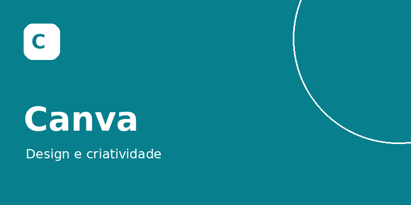
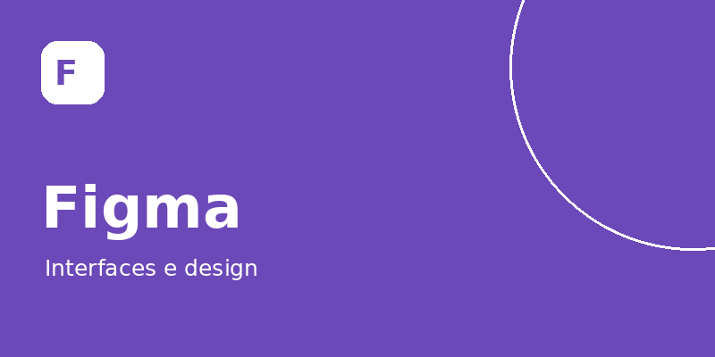
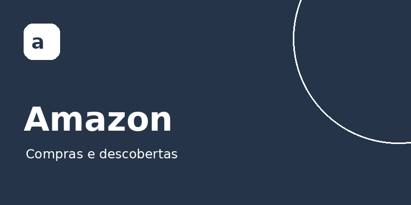

# Meus sites favoritos: Laine Adriele da Silva Moraes

Clique nas imagens ou nos links abaixo para acessar meus sites favoritos.

<table>
<tr>
<td align="center" width="33%">
<h1>YouTube</h1>
 
<a href="https://www.youtube.com/">Acessar YouTube ↗</a>

Vídeos para aprender e se divertir.

</td>
<td align="center" width="33%">
<h1>Canva</h1>
 
<a href="https://www.canva.com/">Acessar Canva ↗</a>

Criação de apresentações e materiais visuais.

</td>
<td align="center" width="33%">
<h1>Figma</h1>
 
<a href="https://www.figma.com/">Acessar Figma ↗</a>

Criação de layouts, interfaces e protótipos.

</td>
</tr>
<tr>
<td align="center">
<h1>LinkedIn</h1>
 
<a href="https://www.linkedin.com/">Acessar LinkedIn ↗</a>

Conexões profissionais e oportunidades de carreira.

</td>
<td align="center">
<h1>Amazon</h1>
 
<a href="https://www.amazon.com.br/">Acessar Amazon ↗</a>

Pesquisa de produtos, livros e compras online.

</td>
<td></td>
</tr>
</table>

## Sobre a atividade

Agenda 12 de Desenvolvimento de Sistemas I. As imagens são ilustrações representativas produzidas para a atividade.

A galeria acima pode ser utilizada diretamente no GitHub. O projeto HTML completo está em [index.html](index.html), com o título da aba, os títulos dos sites, imagens locais, links e comentários solicitados.

## Abrir a página HTML

Use **Code > Download ZIP**, extraia a pasta e abra **index.html** no navegador, mantendo as imagens e o CSS na mesma pasta.

## Arquivos do projeto

- [index.html](index.html): página principal comentada.
- [estilo.css](estilo.css): apresentação visual responsiva.
- Cinco imagens PNG locais.
- [Captura da página](captura_pagina.jpg): execução no navegador.
- [Captura do código](captura_codigo.jpg): código HTML comentado.
- [codigo.html](codigo.html): visualizador do código.
